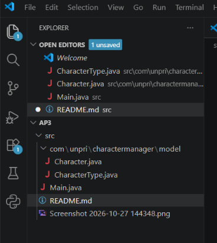

Deskripsi

Proyek ini merupakan implementasi dasar aplikasi Character Manager menggunakan bahasa pemrograman Java dan konsep Object-Oriented Programming (OOP). Program memiliki class Character, enum CharacterType, dua constructor, getter dan setter, serta method toString(). Pada pengembangan ini, ditambahkan atribut mana, validasi nilai mana, dan method isAlive().

Fitur Program

Membuat tiga karakter: Arjuna, Merlin, dan Athena.

Menampilkan informasi karakter melalui method toString().

Menaikkan level karakter dan menghitung ulang HP serta attack.

Menambahkan atribut mana dengan getter dan setter.

Memeriksa apakah karakter masih hidup menggunakan isAlive().

Menolak nilai mana negatif dengan IllegalArgumentException.

https://docs.google.com/document/d/12jpQKsBpTNQYiyN0xItB5gu7oqW-SOBU/edit?usp=drive_link&ouid=117130834806065707688&rtpof=true&sd=true